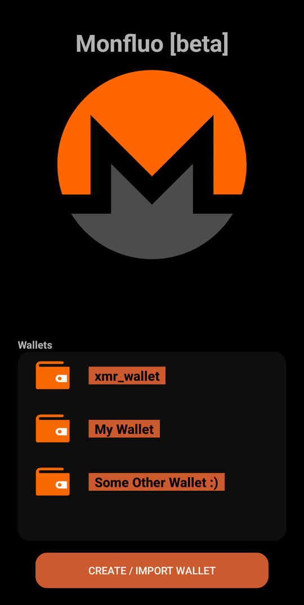
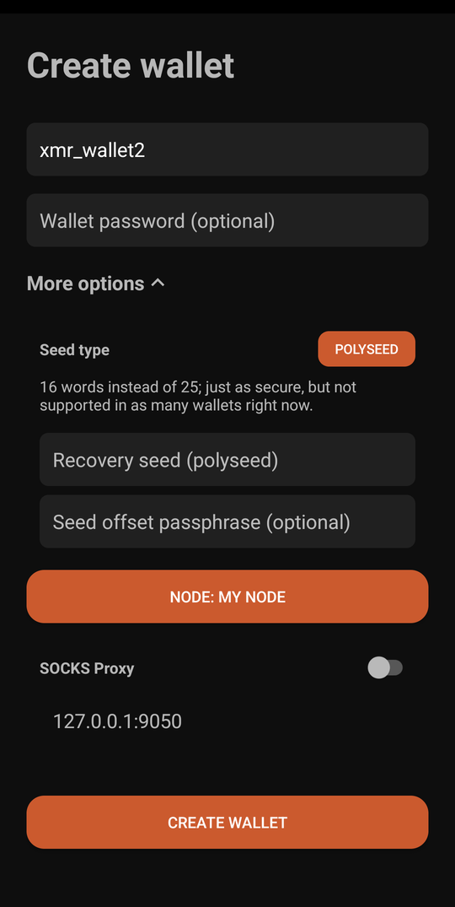
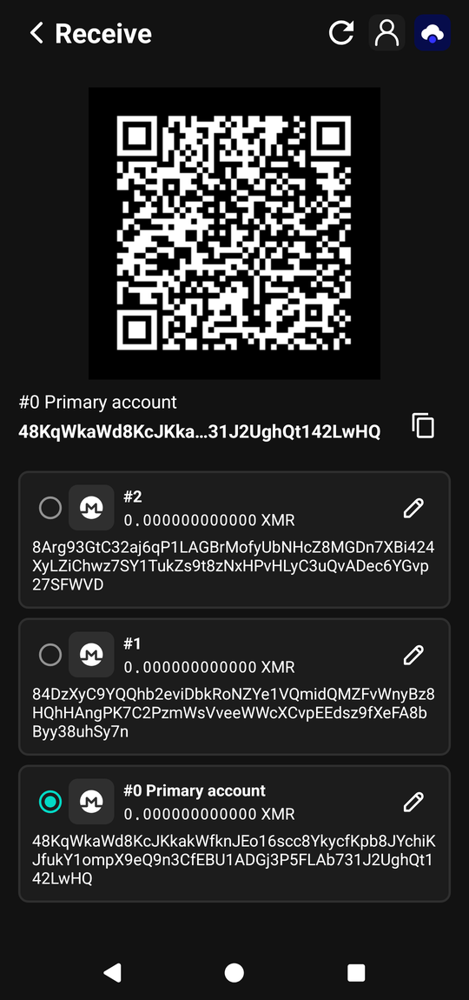
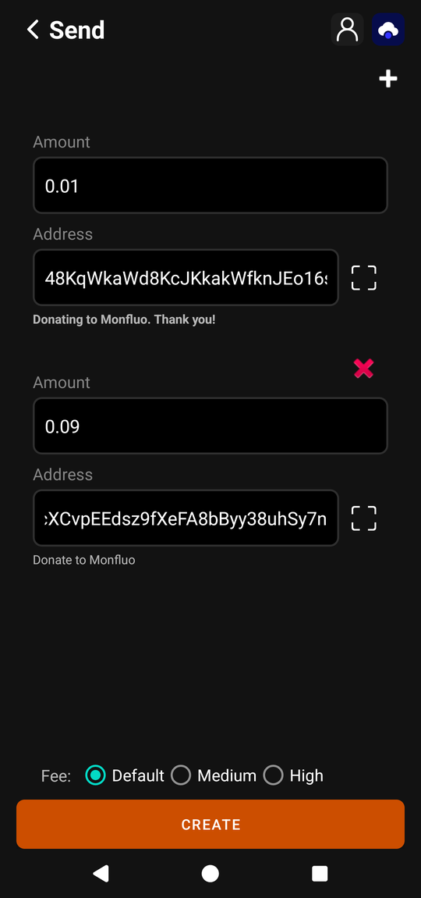
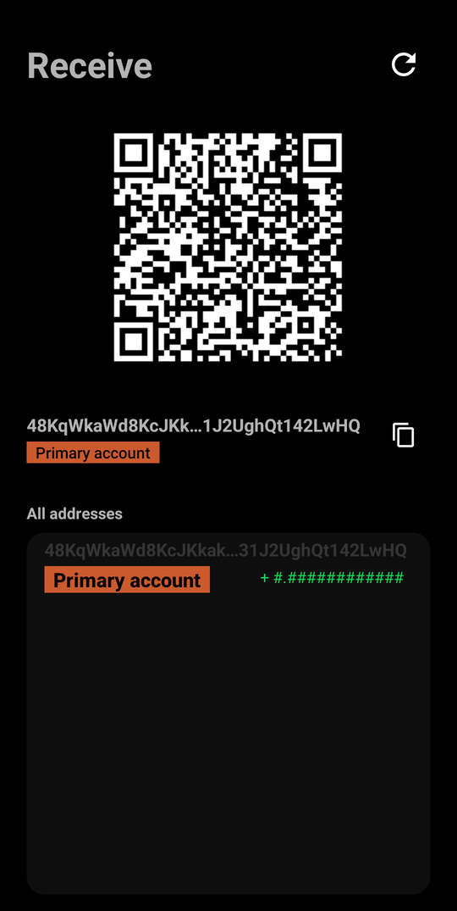
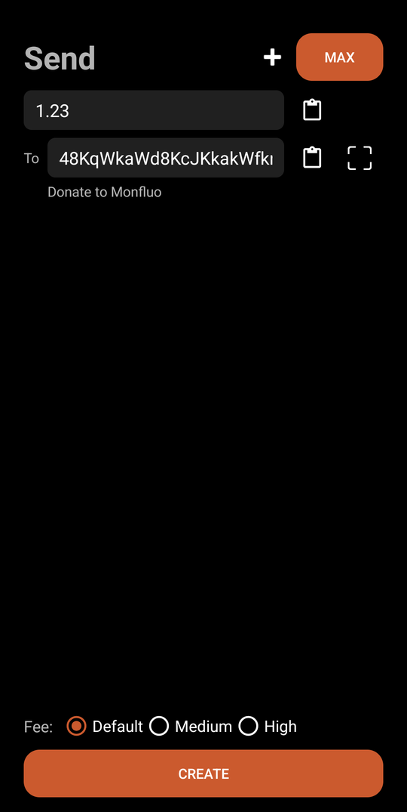

# Monfluo

A no-bullshit, pure Monero wallet suitable for both newcomers and experienced users.  

Monfluo is a fork of Mysu (previously known as MyNero) originally developed by pokkst.
Mysu was a fork of Monerujo developed by m2049r.

## Download

### Codeberg

You can download the latest APK from the [releases tab](https://codeberg.org/acx/monfluo/releases).  
There are several APKs for different architectures, you probably want the one with "arm64" in the name, but if you are not sure you can just grab the universal one.  

### F-Droid

Monfluo is available in our F-Droid repositories.  

* Clearnet (default): https://fdroid.monfluo.org/fdroid/repo/

* Onion: http://fdroid.monfluovo5ghg5znchzsbkedeivinvyletxhn7f3ju5lre3syy2pezqd.onion/fdroid/repo/

### Using experimental/nightly builds from CI

The CI is configured to build the app for every new commit.
You can use those builds if you want to help with testing.
Be aware though, those builds have a higher chance of having bugs.
Release builds and experimental builds can be installed on the same device without interfering with each other.

- Download the latest CI build [here](https://codeberg.org/acx/monfluo/actions)
    - Click on the newest action that is successful (has a green tick to the left).
    - Look for `apks` artifact and click on it (this will start the download of a zip file).
    - Unzip the archive, find the app (it has .apk extension) and install it on your device.

## Disclaimer

Be sure to back up your wallet recovery phrase (and seed offset passphrase, if you set one).  
We are NOT responsible for lost or stolen funds.

## Notable Features

- Coin control (UTXO/enote management)
- Seed passphrases/offsets
- Polyseed
- Multi wallet & multi account
- Select your own node
- NO support for other coins
- NO integrations (exchange rates, swapping services, fiat on/off-ramps, etc.)

## Screenshots

## HOW TO BUILD

See [the instructions](doc/BUILDING-external-libs.md)  
Then, fire up Android Studio and build the APK like any other android app.

## Translations

[Weblate](https://hosted.weblate.org/projects/monfluo) is used to translate Monfluo.

## Donations

Maintaining Monfluo incurs some costs, so please consider donating.

XMR address: `48KqWkaWd8KcJKkakWfknJEo16scc8YkycfKpb8JYchiKJfukY1ompX9eQ9n3CfEBU1ADGj3P5FLAb731J2UghQt142LwHQ`

[Click to paste the address in your wallet](monero:48KqWkaWd8KcJKkakWfknJEo16scc8YkycfKpb8JYchiKJfukY1ompX9eQ9n3CfEBU1ADGj3P5FLAb731J2UghQt142LwHQ), or manually scan the QR code below:

#### Expenses (excluding developer time)

- Build server for CI/CD: 10 EUR / month
- F-Droid servers: 8 EUR / month 
- Domain (monfluo.org): 15 EUR / year

## Support / Chats

Matrix room: https://matrix.to/#/%23monfluo%3Amonero.social?via=monero.social  

SimpleX chat (by rottenwheel): https://simplex.chat/contact#/?v=2-7&smp=smp%3A%2F%2F1OwYGt-yqOfe2IyVHhxz3ohqo3aCCMjtB-8wn4X_aoY%3D%40smp11.simplex.im%2FA89PUHNXaCYLa48cSAWH5k8orgG1ebbt%23%2F%3Fv%3D1-3%26dh%3DMCowBQYDK2VuAyEAVG3M3jjFAELlA2zJtOMq--p1V0yfN252oglNp4ZR1wM%253D%26srv%3D6ioorbm6i3yxmuoezrhjk6f6qgkc4syabh7m3so74xunb5nzr4pwgfqd.onion&data=%7B%22groupLinkId%22%3A%22aSaW9b7I_yHrzvsstF-hYA%3D%3D%22%7D  

